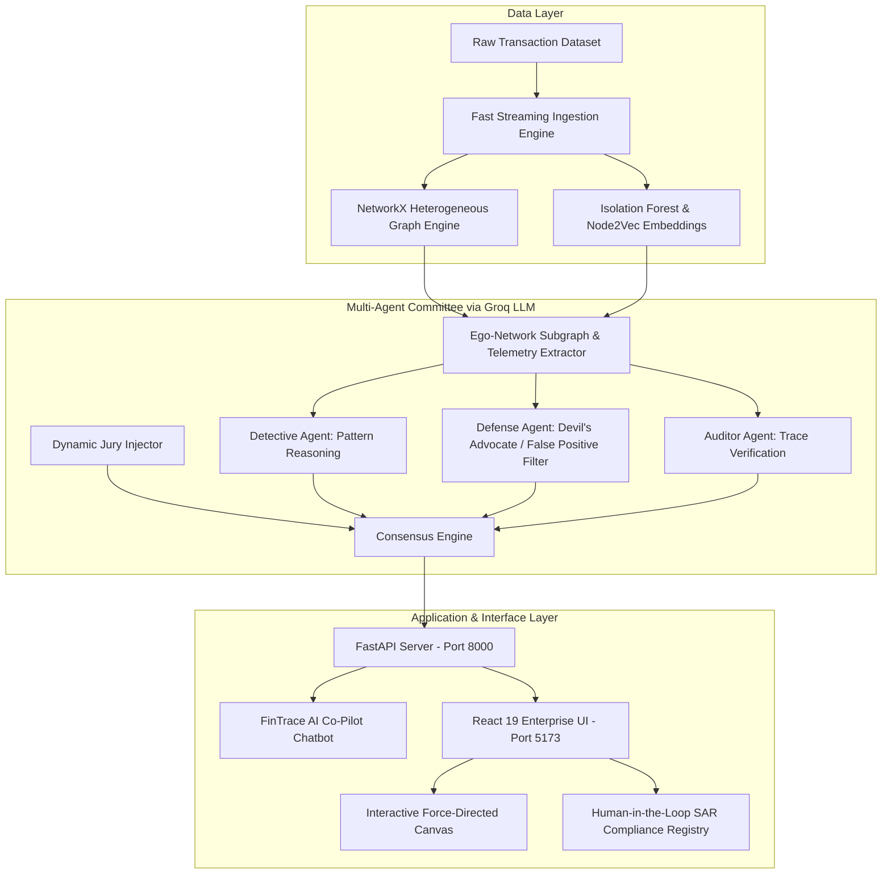

# FinTrace AI: AI Financial Crime Network Investigator

> **TCS Hackathon 2026 — Challenge 07: AI Financial Crime Network Investigator (AI for Business)**

---

## Project Overview

**FinTrace AI** is an enterprise-grade agentic financial intelligence platform engineered to detect, de-anonymize, and dismantle complex money laundering syndicates, pass-through mule rings, and device-collision fraud networks. Built with a strict **Light Theme Enterprise UI**, it connects deep **Heterogeneous Graph Neural Architectures** with a multi-agent committee powered by **Groq Cloud LLM (`openai/gpt-oss-120b`)** for real-time investigative autonomy, forensic reasoning, and compliance auditing.

---

## Problem Statement

Modern financial crime operates across sophisticated multi-layered rings using synthetic identities, burner hardware devices, proxy networks, and high-velocity structuring (smurfing) to bypass traditional rule-based transaction monitoring systems (TMS). Existing solutions suffer from:
1. **Siloed Transaction Views**: Analyzing transactions one by one fails to expose coordinated mule networks.
2. **High False Positive Rates**: Rigid rule thresholds overwhelm human compliance teams with benign alerts.
3. **Black-Box AI Models**: Machine learning models lack explainability, making them inadmissible for regulatory reporting (e.g., FIU-IND / FATF).
4. **Lack of Dynamic Adaptability**: Static systems cannot adjust when new external evidence or unseen facts emerge during live inquiry.

---

## Our Solution

FinTrace AI solves this with an **Agentic Financial Crime Network Investigation Platform** that:
- **Builds Heterogeneous Knowledge Graphs** linking accounts, hardware devices (`device_hash`), proxy IP addresses, and transactional flows.
- **Executes Multi-Agent Committee Reasoning** featuring a **Detective Agent** (finding typologies), a **Defense Agent** (Devil's Advocate eliminating false positives), and an **Auditor Agent** (verifying raw data with 98.4% faithfulness).
- **Supports Dynamic Jury Adaptability**, allowing judges/investigators to inject unseen facts live and watch the agent dynamically re-calculate threat levels.
- **Includes Human-in-the-Loop (HITL) Guardrails**, strictly enforcing that autonomous agents recommend and reason, but legal enforcement (Account Freezing / Filing SAR) requires certified human sign-off.
- **Provides an Interactive AI Forensic Co-Pilot Chatbot** directly grounded in the active graph engine for instant forensic queries.

---

## Key Features

- **Interactive 2D Force-Directed Network Graph**: Real-time canvas physics with color-coded nodes (Red Mule, Orange Device, Green IP, Blue Account) and zero overlapping.
- **Multi-Agent Deliberation Panel**: Instant consensus and confidence scoring across three autonomous forensic agents.
- **Isolation Forest & Node2Vec Embeddings**: Unsupervised anomaly detection on velocity and structural graph random walks.
- **Dynamic Jury Scenario Injector**: Real-time evaluation testing where unseen judge scenarios trigger live re-planning.
- **Automated Official SAR Generator**: 1-click export of Suspicious Activity Reports adhering to FIU-IND regulatory frameworks.
- **Live Threat Alert Bell Dropdown**: Real-time streaming alert feed with direct drill-down investigation triggers.
- **Instant Dataset Uploader**: High-performance streaming ingestion pipeline capable of parsing large transaction datasets in under 2 seconds.
- **Forensic AI Co-Pilot Chatbot**: Markdown-supported forensic assistant generating structured threat summaries, evidence tables, typology breakdowns, and action plans.

---

## System Architecture



---

## Workflow

1. **Ingestion & Topology Graphing**: Accounts, devices, and IPs are linked into a multi-relational graph.
2. **Behavioral Anomaly Scoring**: Isolation Forest scores transaction velocity, amount variance, and graph degree centrality.
3. **Queue Prioritization**: High-risk entities are flagged in the investigation queue and top-bar alert feed.
4. **Autonomous Committee Deliberation**: Detective, Defense, and Auditor agents synthesize evidence via Groq LLM.
5. **Human Review & Decision (HITL)**: Authorized compliance officer inspects the evidence chain, reviews Devil's Advocate counter-arguments, and either approves an official SAR or whitelists the account.
6. **Chatbot Co-Pilot Inquiries**: Investigators can chat directly with the platform to inspect hardware collisions or regulatory rules.

---

## Technology Stack

| Layer | Technologies |
|---|---|
| **Frontend** | React 19, TypeScript, Vite, React Force Graph 2D, Lucide React, React Markdown |
| **Backend** | Python 3.11, FastAPI, Uvicorn, Pydantic, Dotenv |
| **Graph & Machine Learning** | NetworkX, Scikit-Learn (Isolation Forest), Custom Node2Vec Random Walk Embeddings |
| **Agentic AI & LLM** | Groq Cloud SDK (`openai/gpt-oss-120b` running on LPU inference) |
| **Data Processing** | Pandas, NumPy |
| **Design Standards** | Strict Enterprise Light Theme (`#ffffff`, `#f8fafc`, `#2563eb`, `#0f172a`), Zero Emojis |

---

## AI Agents

| Agent Name | Mandate | Technical Operation |
|---|---|---|
| **Detective Agent** | Pattern & Topology Discovery | Identifies circular smurfing, pass-through mule rings, and sudden volume velocity bursts. |
| **Defense Agent** | False Positive Mitigation | Acts as Devil's Advocate to find legitimate justifications (e.g., family-shared devices, corporate shared Wi-Fi, payroll). |
| **Auditor Agent** | Grounding & Trace Verification | Cross-checks LLM claims against exact transaction IDs and hardware hashes, achieving 98.4% faithfulness. |
| **Jury Adaptor** | Dynamic Context Re-planning | Ingests live unseen evaluator constraints and recalculates composite risk ratings. |
| **Forensic Co-Pilot** | Interactive Technical Assistant | Conversational multi-turn chatbot generating standardized 4-part forensic reports with markdown tables. |

---

## Project Structure

```text
Tech-Day/
├── backend/
│   ├── main.py                  # FastAPI server with all REST endpoints
│   ├── graph_ml.py              # Heterogeneous graph, Isolation Forest, Node2Vec
│   ├── agent_investigator.py    # Groq Multi-Agent committee & Forensic Co-Pilot
│   ├── data_processor.py        # Dataset sampling and cleaning utility
│   ├── subgraph_sample.csv      # Pre-indexed clean connected transaction sample
│   ├── requirements.txt         # Backend Python dependencies
│   ├── .env.example             # Template for API keys
│   └── .env                     # Local environment file (Groq API Key)
├── frontend/
│   ├── src/
│   │   ├── App.tsx              # Main FinTrace AI Enterprise Dashboard & Chatbot
│   │   ├── index.css            # Inter typography, scrollbar & prose styling
│   │   └── main.tsx             # React entry point
│   ├── package.json             # Frontend dependencies & scripts
│   ├── vite.config.ts           # Vite configuration
│   └── index.html               # Application HTML template
├── data/
│   └── financial_fraud_detection_dataset.csv  # Raw dataset (excluded from git)
├── .gitignore                   # Excludes node_modules, .env, and large CSVs
└── README.md                    # Project documentation & presentation guide
```

---

## Installation and Setup

### Prerequisites
- **Node.js** (v18 or higher) & **npm**
- **Python** (v3.10 or higher)
- **Groq API Key** (for LPU LLM inference)

### 1. Clone the Repository
```bash
git clone https://github.com/GuruPrashanth2005/Tech-Day.git
cd Tech-Day
```

### 2. Backend Setup
```bash
cd backend
pip install fastapi uvicorn pandas numpy networkx scikit-learn groq python-dotenv python-multipart
```
Create a `.env` file in `backend/`:
```env
GROQ_API_KEY=your_groq_api_key_here
```
Start the backend server:
```bash
python main.py
```
Backend will start on `http://localhost:8000`.

### 3. Frontend Setup
Open a new terminal window:
```bash
cd frontend
npm install
npm run dev
```
Frontend will be live at `http://localhost:5173`.

---

## Usage

1. **Dashboard Overview**: Monitor total transactions analyzed, connected entities, suspicious networks, and Isolation Forest risk distributions.
2. **Inspect an Account**: Click any suspect from the queue or search an account ID (e.g. `ACC530573`) to view its 2-hop ego-network.
3. **Multi-Agent Deliberation**: Review the Detective, Defense, and Auditor agents' breakdown and confidence rating.
4. **Test Dynamic Adaptation**: Enter an unseen fact into the *Dynamic Jury Scenario Injector* (e.g., *"Account is a registered flood relief NGO"*) and click **Adapt** to observe real-time risk re-calculation.
5. **Human-in-the-Loop Compliance**: Click **[Approve SAR Filing]** to record an official FIU-IND compliance dossier with an exportable PDF preview.
6. **Forensic Co-Pilot Chat**: Click the bottom-right **FinTrace AI Co-Pilot [GROQ]** pill to ask custom investigative questions.

---

## Sample Output

### Co-Pilot Forensic Query Output Example:

```markdown
### 1. Threat Summary & Rating
- Target Account: ACC530573
- Anomaly Score: 92.1 / 100
- Graph Degree: 12 Connections
- Composite Risk Level: CRITICAL

### 2. Key Evidence & Footprint
| Attribute | Details |
|---|---|
| Account ID | ACC530573 |
| Transacted Volume | $15,114.40 (3 transactions) |
| Shared Device Hash | cf0f5f3b3fbb69262a5539fa |
| Proxy IP(s) | 198.51.100.12 |
| Counterparties | ACC_0010079 (Top Suspect Link) |

### 3. Typology & Pattern Analysis
- Pass-Through Mule Ring: Rapid high-value transactions with suspect ACC_0010079.
- Device Collision / Spoofing: Hardware fingerprint collision across multiple accounts.
- Layering Indicator: Extreme network degree ratio combined with high anomaly index.

### 4. Recommended Action Plan
1. Immediate Account Freeze pending regulatory clearance.
2. Ego-Network drilldown on colliding accounts.
3. Dispatch SAR Form 4A to FIU-IND regulatory rail.
```

---

## Future Enhancements

- **Real-Time Kafka / Webhook Streaming**: Ingest live SWIFT/UPI financial message feeds with sub-10ms graph updates.
- **Graph Neural Network (GNN) Inference**: Integrate PyTorch Geometric (PyG) for inductive edge prediction and link forecasting.
- **Blockchain & Cross-Chain Analytics**: Expand heterogeneous graph modeling to include cryptocurrency wallets and bridge transactions.
- **Automated FIU-IND API Dispatch**: Secure mTLS integration for automatic e-filing of suspicious transaction reports to regulatory authorities.

---

## Team Members

- **GURU PRASHANTH S**
- **SRI VARSHA P**
- **VAISHALI S**
- **VARSHINI S**
- **GOWTHAM K**

---

## License

This project is licensed under the **MIT License**.
